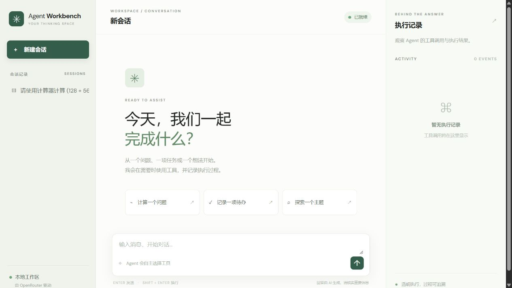
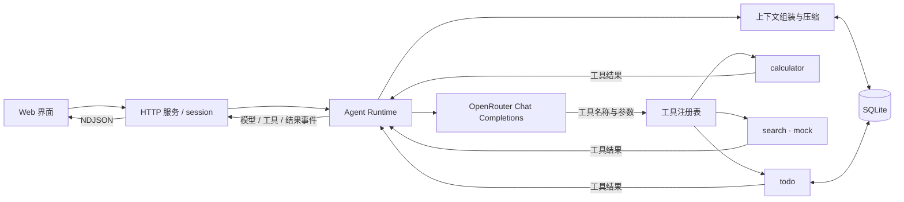

# Agent Workbench

一个从零实现的最小 Agent Runtime，使用 OpenRouter 的真实大模型 API，通过网页展示对话、工具调用与执行记录。项目不依赖 LangGraph、OpenHands 等 Agent 框架；模型调用、工具注册、执行循环、会话隔离和上下文管理均由项目自行实现。



> 截图为真实运行的工作台首页。左侧是会话列表，中间是聊天区，右侧显示执行记录。

## 功能概览

- **Agent 循环**：模型基于工具 Schema 选择直接回答或调用工具；Runtime 执行工具后回填结果，继续调用模型，直到输出答案或达到单次运行的 8 轮上限。
- **工具注册**：统一注册名称、描述、参数 Schema 和执行函数；执行前检查必填字段、基本类型、枚举和多余字段。
- **三个工具**：`calculator` 使用 AST 白名单计算表达式；`search` 返回明确标记的模拟结果；`todo` 支持新增、列出和完成当前会话的待办。
- **会话隔离与恢复**：会话、消息、摘要、待办与执行记录保存在 SQLite；可切换会话，关闭页面或重启后重新选择会话继续聊天。
- **上下文管理**：近期对话保留原文，较早的完整轮次分片生成增量摘要；压缩失败时保留原始历史并停止本次请求。
- **可观察性**：按 `run_id` 记录模型调用、工具输入输出、耗时、重试次数、压缩与错误事件，前端提供展开查看。
- **基础恢复**：支持取消信号、网络有限重试和中断工具调用的历史修复；不会自动重新执行结果未知的工具。

## 快速开始

### 环境要求

- Python **3.10+**。项目运行时仅使用 Python 标准库，无需安装第三方 Python 依赖。
- OpenRouter API Key，以及一个支持工具调用的模型。
- 首次调用模型需要可连接 OpenRouter 的网络；API 调用可能产生费用。

### 1. 获取项目

```bash
git clone https://github.com/yezhi-0430/agent-workbench.git
cd agent-workbench
```

### 2. 配置环境变量

Windows PowerShell：

```powershell
Copy-Item .env.example .env
```

macOS / Linux：

```bash
cp .env.example .env
```

编辑 `.env`：

```dotenv
OPENROUTER_API_KEY=填写你的密钥
OPENROUTER_MODEL=openai/gpt-4o-mini
```

模型可根据需要更换；应选择支持工具调用的模型。也可以直接设置同名系统环境变量，**已有环境变量优先于 `.env`**。请勿把真实密钥提交到仓库；`.env` 和 `agent.db` 已列入 `.gitignore`。

### 3. 启动

```bash
python server.py
```

打开 [http://127.0.0.1:8765](http://127.0.0.1:8765)。在终端按 `Ctrl+C` 停止服务。数据库默认保存在启动目录下的 `agent.db`。

### 4. 运行测试

```bash
python -m unittest discover -s tests -v
```

自动化测试使用可控模型替身，不需要 API Key，也不会请求真实模型。

## 界面演示

1. 输入“我叫小林”，再问“我叫什么？”，检查连续对话。
2. 输入“请计算 (128 + 56) × 3”，展开右侧 `calculator` 卡片，查看参数、结果与耗时。
3. 输入“添加待办：准备周报”；新建另一个会话并查询待办，检查会话隔离，再切回原会话继续追问。
4. 对话足够长时观察“上下文压缩”事件，再追问前文事实；摘要有损，结果需要实际核对。

右侧事件会按单次运行分组。模型调用卡片展示模型名称、成功请求耗时和重试次数；工具卡片展示调用参数、结果和状态。历史记录保存在本地数据库，刷新后重新选择对应会话即可查看。

## 系统设计



一次运行的流程：

1. 用户提交消息；后端根据 `session_id` 读取历史并组装上下文。
2. 将消息与注册工具的 Schema 发给模型，解析最终回答或 `tool_calls`。
3. 对工具名称和参数做校验，执行工具并将结果以工具消息回填。
4. 模型根据结果继续调用工具或返回答案；异常、取消或达到最大轮次时结束。
5. 执行事件按会话与 `run_id` 持久化，并逐行推送至前端。

同一 session 同时只允许运行一个请求；不同 session 可分别处理。SQLite 访问通过锁串行化。同一 session 在忙碌时，新的聊天请求会收到 busy 响应，当前实现**不提供消息排队**。

## Memory：召回时机与上下文放置

当前 Memory 的范围是**单个 session 的历史消息、摘要和待办状态**；没有跨 session 的长期用户画像，也没有按语义检索旧消息。

### 什么时候召回？

- **每次用户发消息**：按 session ID 读取该会话历史及必要摘要，用于本轮回答和追问。
- **需要待办状态时**：由模型选择 `todo` 工具，从数据库读取当前会话的最新状态。数据库是待办的权威来源。
- **历史过长时**：超过 8 个用户轮次，或近期消息超过约 22,000 字符时，压缩较早的完整轮次。这里按字符估算，并非精确 token 计算。

### 放在什么位置？

发送给模型的内容通常按以下顺序组装：

```text
系统指令
  → 旧对话摘要（仅已触发压缩时）
  → 近期完整对话（包括工具调用与结果）
  → 本次用户输入
```

运行中，工具结果追加到当前消息序列，再发送给模型。压缩过程分片处理旧记录，并和已有摘要合并；全部成功后才更新摘要和覆盖位置。摘要过长或压缩失败时，本次请求停止，原始历史保留。

### 边界

摘要可能遗漏或误记，生成摘要也会增加模型调用与费用。字符预算不含完整 Schema 和供应商协议开销，无法保证适配所有模型的上下文窗口；单轮内工具结果过长时会停止并提示缩小查询。原始历史会保留，但当前没有实现基于语义的原文自动回查。

## 异常、取消与安全边界

- 临时连接错误、超时和 HTTP 429/500/502/503/504 最多重试两次；认证错误等不会重试。
- 取消信号会在运行流程检查时生效，**不能立刻中断正在进行的阻塞模型请求**。
- 进程在工具调用与结果之间退出时，后续请求会对缺失结果补充“执行结果未知”，不会自动重跑有副作用的操作；仍需检查实际状态，当前没有通用幂等保证。
- `search` 为模拟工具，不能提供实时搜索结果；工具参数校验实现的是基础 Schema 子集，不是完整 JSON Schema 校验器。
- 事件流是逐条发送的 JSON 事件，**最终模型回答目前不是逐 token 流式输出**。没有专门解析和展示模型的内部推理字段。
- 应用仅绑定本机回环地址，没有登录及多用户授权；对话与工具结果明文保存在本地，请勿将服务直接暴露到公网，也不要提交数据库。

## 测试覆盖

| 场景 | 相关测试 |
| --- | --- |
| Agent 循环、工具注册与校验 | `test_agent.py`、`test_registry.py`、`test_todo_validation.py` |
| 会话隔离、持久化与并发 | `test_persistence.py`、`test_concurrency.py` |
| 摘要、上下文预算与长工具结果 | `test_summary.py`、`test_summary_integrity.py`、`test_context_budget.py`、`test_tool_budget.py` |
| 取消、断线与进程退出恢复 | `test_cancellation.py`、`test_http_disconnect.py`、`test_recovery.py`、`test_crash_integration.py` |
| 重试、执行记录与运行分组 | `test_resilience.py`、`test_trace_storage.py`、`test_trace_http.py`、`test_run_trace.py` |

真实 OpenRouter 曾用于验证对话追问、计算器、待办隔离和构造的长对话摘要；这些是特定场景下的验证，不代表所有模型和输入均有相同表现。断线与进程退出测试使用可控模型替身。

## 项目结构

```text
agent-workbench/
├── agent.py              # 模型请求、上下文和 Agent 主循环
├── tools.py              # 工具定义、注册与参数校验
├── storage.py            # SQLite 会话、消息、待办和事件存储
├── server.py             # HTTP 接口、运行状态和事件推送
├── config.py             # .env 配置加载
├── static/               # 网页界面
├── tests/                # 自动化测试
├── docs/images/          # 工作台截图
├── AI_NOTES.md           # AI 使用与问题解决记录
└── .env.example          # 不含密钥的配置模板
```

AI 辅助开发过程及问题记录见 [AI_NOTES.md](AI_NOTES.md)。
